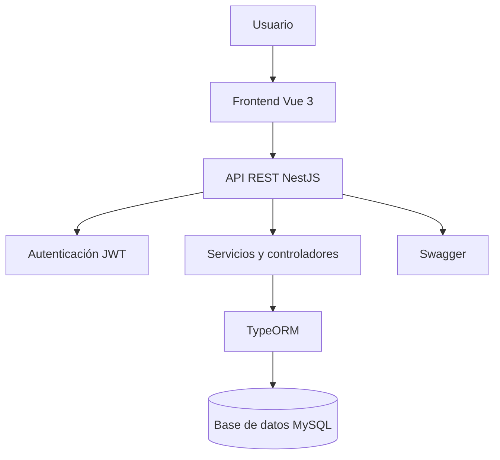

# README – Documentación del software GameHub IPVG

## 1. Descripción del proyecto

**GameHub IPVG** es una aplicación web para gestionar torneos de videojuegos y deportes electrónicos (eSports) dentro de la comunidad IPVG.

El sistema permite registrar usuarios, administrar equipos, inscribirlos en torneos, programar partidos, registrar resultados y consultar rankings. Cuenta con perfiles de estudiante y administrador, con permisos diferenciados.

**Repositorio principal:** https://github.com/N4ch002/gamehub-ipvg  
**Repositorio de trabajo colaborativo:** https://github.com/DarkAngelCV/gamehub-ipvg-colaboracion

## 2. Integrantes

| Integrante | Rama de trabajo |
|---|---|
| Ignacio Fuentes | `rama-integrante-1` |
| Cristian Vasquez | `rama-integrante-2` |

## 3. Tecnologías utilizadas

### Frontend
- Vue 3
- Vite
- Vue Router

### Backend
- NestJS
- TypeORM
- MySQL
- class-validator
- class-transformer
- JWT
- bcryptjs
- Swagger

### Pruebas y trabajo colaborativo
- Jest
- Git
- GitHub
- GitHub Projects (tablero Kanban)

## 4. Arquitectura del sistema

El proyecto utiliza una arquitectura cliente-servidor. El frontend desarrollado en Vue se comunica mediante solicitudes HTTP con la API REST construida en NestJS. El backend procesa las solicitudes, aplica las validaciones y se comunica con la base de datos MySQL mediante TypeORM.



### Organización del proyecto

```text
gamehub-ipvg/
├── backend/
│   ├── database/
│   │   └── seed.sql
│   ├── src/
│   │   ├── auth/
│   │   ├── equipos/
│   │   ├── inscripciones/
│   │   ├── partidos/
│   │   ├── ranking/
│   │   ├── resultados/
│   │   ├── torneos/
│   │   └── usuarios/
│   ├── .env.example
│   └── README.md
│
├── frontend/
│   ├── src/
│   │   ├── components/
│   │   ├── router/
│   │   ├── services/
│   │   └── views/
│   └── README.md
│
└── README.md
```

## 5. Modelo de datos

Las principales entidades del sistema son:

| Entidad | Descripción |
|---|---|
| Usuarios | Almacena los datos de los usuarios y sus roles. |
| Equipos | Registra los equipos y sus capitanes. |
| Equipo_integrantes | Relaciona usuarios con los equipos a los que pertenecen. |
| Torneos | Almacena la información de los torneos. |
| Inscripciones | Relaciona equipos con torneos y registra el estado de la inscripción. |
| Partidos | Almacena los encuentros programados entre equipos. |
| Resultados | Registra los marcadores y ganadores de los partidos. |

### Relaciones principales

- Un usuario puede ser capitán de uno o más equipos.
- Un equipo puede tener varios integrantes y un usuario puede pertenecer a varios equipos.
- Un equipo puede inscribirse en distintos torneos.
- Un torneo puede tener varias inscripciones y partidos.
- Un partido enfrenta a dos equipos.
- Un partido puede tener un resultado registrado.
- Un resultado puede tener un equipo ganador; en caso de empate, el ganador queda sin asignar.

## 6. Reglas de negocio

1. Un equipo no puede inscribirse más de una vez en el mismo torneo.
2. Un torneo no puede superar su capacidad máxima de equipos.
3. No se permiten inscripciones en torneos cerrados o fuera del plazo establecido.
4. La inscripción de un equipo debe ser realizada por su capitán o por un administrador.
5. Los dos equipos de un partido deben estar inscritos y aceptados en el mismo torneo.
6. Un partido debe existir antes de registrar su resultado.
7. No se puede registrar más de un resultado para el mismo partido.
8. El ganador se determina a partir de los marcadores registrados.
9. Los empates se permiten en torneos con modalidad de liga, pero no en eliminación directa.
10. La administración de torneos, programación de partidos y registro de resultados requiere permisos de administrador.
11. El ranking se calcula a partir de los resultados oficiales: victoria = 3 puntos, empate = 1 punto y derrota = 0 puntos.

## 7. Requisitos previos

Para ejecutar el proyecto se necesita:

- Node.js y npm.
- MySQL 8 o compatible.
- Git.
- Un editor de código, como Visual Studio Code.

## 8. Instalación y ejecución

### 8.1. Obtener el proyecto

Clonar el repositorio:

```bash
git clone https://github.com/N4ch002/gamehub-ipvg.git
cd gamehub-ipvg
```

También se puede utilizar el repositorio colaborativo:

```bash
git clone https://github.com/DarkAngelCV/gamehub-ipvg-colaboracion.git
cd gamehub-ipvg-colaboracion
```

### 8.2. Crear la base de datos

Ingresar a MySQL y ejecutar:

```sql
CREATE DATABASE gamehub_db;
```

La base de datos debe estar vacía antes de iniciar la configuración.

### 8.3. Configurar el backend

Abrir una terminal en la carpeta principal y ejecutar:

```powershell
Copy-Item .\backend\.env.example .\backend\.env
```

Editar `backend/.env` con los datos de conexión de MySQL:

```env
DB_HOST=localhost
DB_PORT=3306
DB_USER=root
DB_PASSWORD=
DB_NAME=gamehub_db
PORT=3000
JWT_SECRET=colocar_una_clave_secreta
```

Se debe reemplazar `DB_PASSWORD` por la contraseña configurada en MySQL y utilizar una clave secreta propia para `JWT_SECRET`.

Instalar dependencias:

```bash
npm install --prefix backend
```

Iniciar el backend:

```bash
npm run start:dev --prefix backend
```

El backend estará disponible en:

`http://localhost:3000`

Al iniciar, TypeORM crea y sincroniza las tablas de acuerdo con las entidades del proyecto. Esta configuración está destinada al entorno de desarrollo y no debe utilizarse como estrategia de migración en producción.

### 8.4. Cargar los datos iniciales

Una vez que el backend haya creado las tablas, se puede ejecutar el archivo:

`backend/database/seed.sql`

El archivo contiene datos iniciales para probar usuarios, equipos, torneos, inscripciones, partidos y resultados.

Se puede abrir y ejecutar desde MySQL Workbench o desde el cliente de MySQL.

**Importante:** el archivo `seed.sql` elimina los registros existentes de las tablas que prepara antes de insertar los datos de prueba. Debe ejecutarse únicamente en una base de datos de desarrollo o prueba. No ejecutarlo sobre una base de datos con información que se quiera conservar.

### 8.5. Configurar el frontend

Abrir otra terminal en la carpeta principal e instalar las dependencias:

```bash
npm install --prefix frontend
```

Iniciar el frontend:

```bash
npm run dev --prefix frontend
```

La aplicación estará disponible en:

`http://localhost:5173`

Se deben mantener abiertas las terminales del backend y del frontend mientras se utiliza el sistema.

## 9. Usuarios de prueba

El archivo `seed.sql` incluye usuarios preparados para probar los distintos perfiles.

### Administrador

| Correo | Contraseña | Rol |
|---|---|---|
| admin@ipvg.cl | 123456 | Administrador |

### Estudiantes

| Nombre | Correo | Contraseña |
|---|---|---|
| Camila Rojas | camila@ipvg.cl | 123456 |
| Diego Soto | diego@ipvg.cl | 123456 |
| Valentina Muñoz | valentina@ipvg.cl | 123456 |
| Matías Pérez | matias@ipvg.cl | 123456 |
| Fernanda Castro | fernanda@ipvg.cl | 123456 |
| Benjamín Lagos | benjamin@ipvg.cl | 123456 |
| Josefa Vidal | josefa@ipvg.cl | 123456 |

Estas credenciales corresponden a los datos de prueba incluidos en el seed. Se recomienda utilizarlas solamente en un entorno local.

### Crear un administrador adicional

El registro público crea usuarios con rol `estudiante`. Para habilitar un usuario como administrador, primero debe registrarse normalmente y después ejecutar, desde MySQL, una actualización como la siguiente:

```sql
USE gamehub_db;

UPDATE usuarios
SET rol = 'admin'
WHERE correo = 'correo-del-usuario@ipvg.cl';
```

Reemplazar el correo por el del usuario registrado. Esta operación debe realizarla alguien con acceso administrativo a la base de datos.

## 10. API REST

La API utiliza JSON para recibir y entregar información. Las rutas protegidas requieren autenticación mediante JWT.

### Autenticación

| Método | Ruta | Descripción | Acceso |
|---|---|---|---|
| POST | `/auth/registro` | Registrar un usuario | Público |
| POST | `/auth/login` | Iniciar sesión | Público |
| GET | `/auth/perfil` | Consultar perfil | Autenticado |
| PATCH | `/auth/perfil` | Actualizar perfil | Autenticado |

### Usuarios

| Método | Ruta | Descripción | Acceso |
|---|---|---|---|
| GET | `/usuarios` | Consultar usuarios | Autenticado |

### Torneos

| Método | Ruta | Descripción | Acceso |
|---|---|---|---|
| GET | `/torneos` | Listar torneos | Público |
| GET | `/torneos/:id` | Consultar un torneo | Público |
| POST | `/torneos` | Crear torneo | Administrador |
| PATCH | `/torneos/:id` | Actualizar torneo | Administrador |
| DELETE | `/torneos/:id` | Eliminar torneo | Administrador |

### Equipos

| Método | Ruta | Descripción | Acceso |
|---|---|---|---|
| GET | `/equipos` | Listar equipos | Público |
| GET | `/equipos/:id` | Consultar equipo | Público |
| POST | `/equipos` | Crear equipo | Autenticado |
| PATCH | `/equipos/:id` | Actualizar equipo | Autenticado |
| DELETE | `/equipos/:id` | Eliminar equipo | Autenticado |

### Inscripciones

| Método | Ruta | Descripción | Acceso |
|---|---|---|---|
| GET | `/inscripciones` | Listar inscripciones | Público |
| GET | `/inscripciones?torneoId=:id` | Filtrar por torneo | Público |
| POST | `/inscripciones` | Inscribir equipo | Autenticado |
| PATCH | `/inscripciones/:id` | Cambiar estado de inscripción | Administrador |

### Partidos

| Método | Ruta | Descripción | Acceso |
|---|---|---|---|
| GET | `/partidos` | Listar partidos | Público |
| GET | `/partidos?torneoId=:id` | Filtrar por torneo | Público |
| GET | `/partidos/:id` | Consultar partido | Público |
| POST | `/partidos` | Programar partido | Administrador |
| DELETE | `/partidos/:id` | Eliminar partido | Administrador |

### Resultados

| Método | Ruta | Descripción | Acceso |
|---|---|---|---|
| GET | `/resultados` | Listar resultados | Público |
| GET | `/resultados/:id` | Consultar resultado | Público |
| POST | `/resultados` | Registrar resultado | Administrador |
| PATCH | `/resultados/:id` | Actualizar resultado | Administrador |

### Ranking

| Método | Ruta | Descripción | Acceso |
|---|---|---|---|
| GET | `/ranking/:torneoId` | Consultar ranking del torneo | Público |

## 11. Ejemplos de solicitudes

### Crear un torneo

`POST /torneos`

```json
{
  "nombre": "Torneo de prueba",
  "videojuego": "Valorant",
  "modalidad": "Liga",
  "fechaInicio": "2026-12-10",
  "cierreInscripcion": "2026-12-05",
  "cupoMaximo": 8,
  "estado": "Abierto"
}
```

### Registrar un resultado

`POST /resultados`

```json
{
  "partidoId": 1,
  "marcadorLocal": 13,
  "marcadorVisitante": 9
}
```

Las solicitudes que requieren permisos deben incluir el token JWT correspondiente en el encabezado:

`Authorization: Bearer TOKEN`

## 12. Documentación Swagger

El backend incluye documentación interactiva mediante Swagger.

Con el backend iniciado, ingresar a:

`http://localhost:3000/docs`

Para probar rutas protegidas:

1. Iniciar sesión mediante `POST /auth/login`.
2. Copiar el valor de `access_token` recibido.
3. Presionar el botón **Authorize** en Swagger.
4. Pegar el token y confirmar.
5. Ejecutar las rutas disponibles según los permisos del usuario.

## 13. Ranking de ejemplo

Para el torneo con ID 1, los resultados de prueba permiten obtener el siguiente ranking:

| Posición | Equipo | PJ | PG | PE | PP | Puntos |
|---:|---|---:|---:|---:|---:|---:|
| 1 | Itata Gaming | 2 | 1 | 1 | 0 | 4 |
| 2 | Ñuble Snipers | 2 | 1 | 0 | 1 | 3 |
| 3 | Virginio eSports | 1 | 0 | 1 | 0 | 1 |
| 4 | Chillán Titans | 1 | 0 | 0 | 1 | 0 |

PJ: partidos jugados. PG: partidos ganados. PE: partidos empatados. PP: partidos perdidos.

## 14. Pruebas del proyecto

### Pruebas automatizadas

Se ejecutaron las pruebas del backend con Jest:

```powershell
$env:NODE_OPTIONS = "--experimental-vm-modules"
npm run test --prefix .\backend -- --runInBand
Remove-Item Env:NODE_OPTIONS
```

**Resultado registrado:** 3 suites de pruebas y 11 pruebas aprobadas.

### Compilación del backend y frontend

Backend:

```bash
npm run build --prefix backend
```

Frontend:

```bash
npm run build --prefix frontend
```

Ambas compilaciones se ejecutaron durante la revisión del proyecto.

### Pruebas manuales

Las siguientes verificaciones sirven como registro de las pruebas funcionales. Completar el resultado de cada caso con la evidencia definitiva de la revisión.

| N.º | Prueba | Resultado |
|---:|---|---|
| 1 | Registro de usuario | Aprobado |
| 2 | Inicio de sesión | Aprobado|
| 3 | Consulta del perfil | Aprobado |
| 4 | Actualización del perfil | Aprobado |
| 5 | Consulta de torneos | Aprobado |
| 6 | Consulta del detalle de un torneo | Aprobado |
| 7 | Inscripción de un equipo | Aprobado |
| 8 | Visualización de inscripciones | Aprobado |
| 9 | Consulta de equipos | Aprobado |
| 10 | Programación de partidos | Aprobado |
| 11 | Consulta de partidos | Aprobado |
| 12 | Registro de resultados | Aprobado |
| 13 | Actualización del ranking después de registrar resultados | Aprobado |
| 14 | Acceso a funciones administrativas | Aprobado |
| 15 | Restricción de rutas protegidas sin token | Aprobado |
| 16 | Validación de datos incorrectos | Aprobado |
| 17 | Respuesta ante recursos inexistentes | Aprobado |

Los casos marcados como aprobados corresponden a las verificaciones funcionales realizadas durante el desarrollo. Los demás deben completarse con el resultado observado y su evidencia.

## 15. Verificación de la base de datos

Para revisar los datos cargados por el seed, se utilizaron consultas SQL como las siguientes:

```sql
USE gamehub_db;

SHOW TABLES;

SELECT id, nombre, alias, correo, rol
FROM usuarios;

SELECT e.nombre, u.alias AS capitan
FROM equipos e
JOIN usuarios u ON u.id = e.capitanId;

SELECT t.nombre AS torneo, e.nombre AS equipo, i.estado
FROM inscripciones i
JOIN torneos t ON t.id = i.torneoId
JOIN equipos e ON e.id = i.equipoId;

SELECT p.id, l.nombre AS local, v.nombre AS visitante,
       r.marcadorLocal, r.marcadorVisitante, g.nombre AS ganador
FROM partidos p
JOIN equipos l ON l.id = p.equipoLocalId
JOIN equipos v ON v.id = p.equipoVisitanteId
LEFT JOIN resultados r ON r.partidoId = p.id
LEFT JOIN equipos g ON g.id = r.ganadorId;

SELECT t.nombre AS torneo, p.id AS partido, p.ronda, p.fechaHora,
       p.estado, l.nombre AS equipoLocal, v.nombre AS equipoVisitante
FROM partidos p
JOIN torneos t ON t.id = p.torneoId
JOIN equipos l ON l.id = p.equipoLocalId
JOIN equipos v ON v.id = p.equipoVisitanteId
ORDER BY t.nombre, p.id;
```

### Datos comprobados

- Se encontraron las siete tablas principales y de relación.
- Se verificaron 8 usuarios, incluido el administrador.
- Se verificaron 6 equipos con sus respectivos capitanes.
- Se encontraron 7 inscripciones: 6 aceptadas y 1 pendiente.
- Se revisaron los partidos, sus estados y los resultados registrados.

## 16. Organización del trabajo

El trabajo se distribuyó entre los integrantes utilizando ramas independientes y solicitudes de integración mediante GitHub.

### Integrante 1 – Ignacio Fuentes

- Configuración inicial del backend.
- Autenticación y gestión de usuarios.
- Gestión de torneos y equipos.
- Inscripciones.
- Estructura inicial del frontend.
- Inicio de sesión y perfil.
- Vistas y funcionalidades iniciales de equipos.
- Correcciones del backend.

### Integrante 2 - Cristian Vasquez

- Gestión de partidos.
- Registro y actualización de resultados.
- Datos iniciales de prueba mediante seed SQL.
- Cálculo y visualización del ranking.
- Pruebas automatizadas con Jest.
- Vistas de torneos e inscripciones.
- Vistas de partidos, resultados y ranking.
- Documentación del proyecto.


## 17. Bitácora de trabajo

Completar esta sección con las fechas reales de trabajo y los principales cambios realizados por cada integrante.

| Fecha | Actividad | Integrante |
|---|---|---|
| [COMPLETAR] | Configuración inicial y organización del proyecto | Ignacio Fuentes |
| [COMPLETAR] | Desarrollo de autenticación, usuarios, equipos y torneos | Ignacio Fuentes |
| [COMPLETAR] | Desarrollo de partidos, resultados y datos de prueba | Integrante 2 |
| [COMPLETAR] | Implementación del ranking y pruebas automatizadas | Integrante 2 |
| [COMPLETAR] | Desarrollo de vistas y documentación final | Ambos integrantes |

## 18. Problemas encontrados y soluciones

Durante el desarrollo se abordaron situaciones como las siguientes:

1. **Configuración de la base de datos:** se revisaron los nombres de las bases de datos configurados en los archivos de ejemplo y en el seed para mantener la conexión con `gamehub_db`.
2. **Validación de solicitudes:** se corrigieron solicitudes que enviaban propiedades no permitidas por los DTO, como `id` o `color`.
3. **Autenticación:** se utilizó JWT para proteger las rutas que requieren un usuario autenticado.
4. **Permisos:** se diferenciaron las operaciones disponibles para estudiantes y administradores.
5. **Resultados:** se implementó el registro de marcadores y la determinación del ganador.
6. **Ranking:** se vinculó el cálculo de puntos con los resultados registrados.
7. **Pruebas:** se ejecutaron pruebas automatizadas y verificaciones manuales para revisar el funcionamiento de los módulos.


## 19. Declaración de uso de inteligencia artificial

Se utilizaron herramientas de inteligencia artificial como apoyo durante el desarrollo y la documentación del proyecto.

| Herramienta | Integrante | Uso |
|---|---|---|
| Claude (Anthropic) | Ignacio Fuentes | Apoyo durante el desarrollo y resolución de dudas. |
| ChatGPT (OpenAI) | Cristian Vasquez | Orientación técnica, explicación de errores, revisión de código, apoyo en pruebas y elaboración de documentación. |

El código y las soluciones sugeridas fueron revisados y probados durante el desarrollo. Los integrantes realizaron las modificaciones necesarias y verificaron el funcionamiento de las funcionalidades antes de integrarlas al proyecto.

### Verificaciones realizadas por los integrantes

Se revisaron las solicitudes de la API, la autenticación, los permisos, la conexión con MySQL, la compilación del frontend y backend, las pruebas automatizadas y el funcionamiento de las vistas principales.

## 20. Resumen final

GameHub IPVG integra funcionalidades para administrar torneos de videojuegos y eSports, gestionar equipos e inscripciones, programar partidos, registrar resultados y consultar rankings.

El proyecto utiliza Vue 3 en el frontend, NestJS en el backend y MySQL como sistema de almacenamiento. Además, incorpora autenticación mediante JWT, validación de datos, control de permisos, documentación Swagger y pruebas automatizadas.

El desarrollo se realizó de manera colaborativa, utilizando ramas de Git y solicitudes de integración para reunir el trabajo de ambos integrantes.
